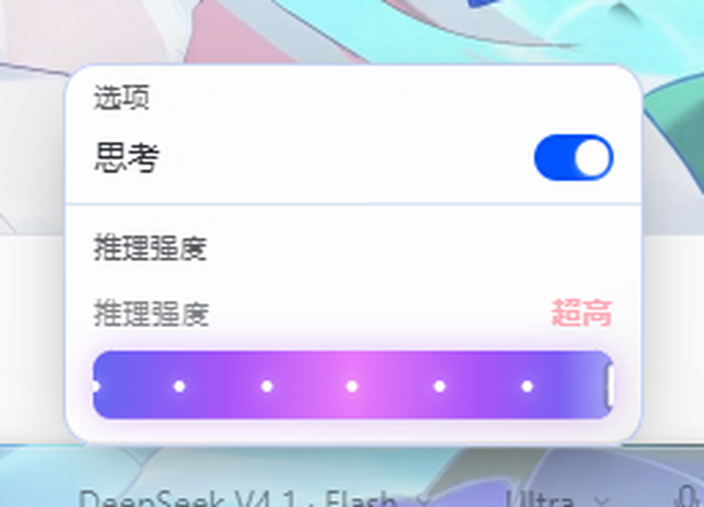

<div align="center">

# Hermes Sliding Reasoning

**Turn Hermes's reasoning-effort picker from a list of radio buttons into a slider you can drag.**

Seven English tiers · model name centered · stardust accelerates with tier · Spring physics · Keyboard accessible

[](https://github.com/NousResearch/hermes-agent)
[](LICENSE)
[](https://github.com/emorybeer9-netizen/effort-slider/releases)

English · [简体中文](README.md)

</div>

---



---

## What it is

That `Off` / `Low` / `Med` button in the corner of Hermes's input box opens a panel with a **Thinking** toggle and seven reasoning-effort tiers: Minimal → Low → Medium → High → Very High → Maximum → Ultra.

Natively it's a column of radio buttons — to change tiers you open the menu, find the row, click it, and the menu closes. **This plugin replaces the column with a single slider.** Press, drag to the tier you want, let go.

It isn't cosmetic. Whichever tier you land on is written back into Hermes and used for your next message.

> **New in v2**: the slider now shows the current reasoning tier (English labels) and the current model name right above it — no menu-opening needed. Stardust particles drift through the filled track, accelerating with the tier. The knob is a true circle, and at Ultra the track end curves into a matching half-circle so nothing leaks.

## What you get

| | |
|---|---|
| **7 English tiers** | Minimal / Low / Medium / High / XHigh / Max / Ultra (Codex style) |
| **At-a-glance info** | Current reasoning tier and model name centered above the slider, following model switches |
| **Stardust** | 5–7 random particles drift from knob to tail along fixed horizontal lanes; faster and denser at higher tiers |
| **Round knob** | 24px circle, never deforms while dragging; at Ultra the track end becomes a matching half-circle |
| **Seven colors** | Cool gray at Minimum, then blue, indigo, purple, violet, magenta, coral. At the top tier the whole track lights up with a purple nebula and a light sweep |
| **Spring physics** | Three modes, each a real per-frame spring integration via rAF — not a CSS transition |
| **Dead zone** | Park the pointer between two tiers and jitter all you like — it won't oscillate |
| **Keyboard accessible** | Arrow keys step one tier, `Home` jumps to Minimal, `End` to Ultra |
| **Applies for real** | One commit on release, written back into Hermes |

## Install

```bash
git clone https://github.com/emorybeer9-netizen/effort-slider \
  "$HOME/.hermes/desktop-plugins/effort-slider"
```

On Windows the path is:

```
%LOCALAPPDATA%\hermes\desktop-plugins\effort-slider
```

You can also grab the zip from [Releases](https://github.com/emorybeer9-netizen/effort-slider/releases) and drop the contents into `desktop-plugins/`.

**Fully quit Hermes and reopen it.** A "推理滑条" (reasoning slider) entry appears in the sidebar; that's the settings page.

## The three feels

Pick one in settings — applies immediately:

| Mode | Settles in | Overshoot | Dead zone | Feel |
|---|---|---|---|---|
| **Fast** (default) | 20 frames | 0.00% | 1.34 tiers | Modeled on Codex: the knob doesn't track your finger, it sits on tiers. Clean. |
| **Clean** | 7 frames | 0.22% | 1.18 tiers | Snappier, a little bounce you can see |
| **Full** | Tracks pointer | Largest | None | Follows your pointer continuously, springs back to the nearest tier on release |

### About the dead zone

While the pointer moves between tiers, there's a band of width `2 × (0.5 + hyst)` in which no tier change fires.

This isn't lazy debouncing — it's required. The first implementation read "advance if past current tier + 1/3, retreat if below − 1/3", and those two thresholds **both held** between 3.33 and 3.67 tiers. Park the pointer in that band and it flip-flopped between High and Very High forever.

Now both directions use the same threshold, so the dead zone is always ≥ 1 tier wide, and inside it `target` stays at the current tier — no movement. On Fast it's 1.34 tiers.

## Other settings

| Option | Meaning |
|---|---|
| Master switch | Turn it off and the native radio list comes straight back |
| Per-tier colors | Off = every tier uses the same color |
| Top-tier nebula | Flowing gradient + light sweep + outer glow |
| Tick dots | Reached tiers light up white |
| Stardust | Particles in the fill; faster and denser at higher tiers; off = static |
| Gloss color | Empty follows the theme; or set `#ffffff`, `oklch(...)` |
| Flow intensity | Opacity of the track gradient |

## Compatibility

- Hermes Desktop `>= 0.23.0`
- Windows / macOS / Linux
- Respects the system "reduce motion" preference

## How it works (read this)

The plugin **takes over the reasoning-effort control at the DOM level**:

1. A `MutationObserver` watches for the menu and finds `[data-slot="dropdown-menu-radio-group"]`
2. The seven native `[role="menuitemradio"]` elements are hidden (**kept, not removed** — the `aria-checked` state and click handlers live on them)
3. A self-drawn slider is inserted ahead of them
4. **On release**, one `click` is dispatched to the matching native item so Radix's own `onSelect` fires and the tier is genuinely written back

Step 4 happens only on `pointerup` — never during the drag. That's not an optimization, it's mandatory: every click makes Hermes tear down and re-insert the tier label `span` inside the model button, and dispatching repeatedly during a drag turns that one-frame gap into a visible white flash.

**Why not an SDK slot?** Hermes doesn't expose a plugin slot for replacing that row. The model menu only offers a `modelMenu.row` decorate hook, which can change a row's icon and badges — not the control itself.

Actual `hermes plugins validate` output:

```
✓ manifest           ✓ security scan — safe
✓ loadable           ✓ no core override
✗ desktop surface — app DOM reach ×3   (catalog rule 8: SDK surface only)
```

Every security check passes. The only failure is "SDK surface only", because the plugin works through the DOM. Once upstream provides a slot this will move to a pure SDK implementation and become eligible for the official catalog.

**Known caveat:** if a Hermes update changes the menu structure, the plugin silently stops working (no slider appears) and breaks nothing — the native list is still there, just not replaced. Turn off the master switch to go fully native.

## License

[MIT](LICENSE)
