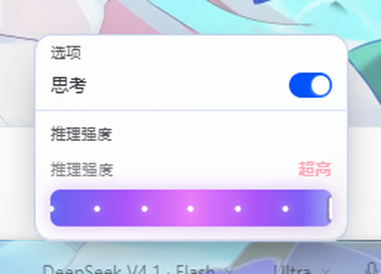

<div align="center">

# Hermes滑动推理

**把 Hermes 的推理强度从「一列单选项」变成一条能拖的滑条。**

七档一色 · 弹簧手感 · 键盘可达 · 拖动即生效

[](https://github.com/NousResearch/hermes-agent)
[](LICENSE)
[](https://github.com/emorybeer9-netizen/effort-slider/releases)

[English](README.en.md) · 简体中文

</div>

---



---

## 是什么

Hermes 输入框右下角那个 `Off` / `Low` / `Med` 按钮，点开是「思考」开关和「推理强度」的七个档位：最小 → 低 → 中 → 高 → 极高 → 最高 → 超高。

原生界面是一列单选项，换个档位要点开、找、点、再点一次收起。**这个插件把它换成一条滑条**——按住拖到想要的位置，松手生效。

不是只改外观。拖到哪一档，档位就真的写回 Hermes，下一条消息就按那个强度跑。

## 效果

| | |
|---|---|
| **七档一色** | 最小是冷灰，往右依次蓝、蓝紫、紫、亮紫、品红、珊瑚。拖到最高档时整条轨道亮起紫色星云，还有一道扫光掠过去 |
| **弹簧手感** | 三种可选，都是 rAF 逐帧积分的真物理，不是 CSS transition。松手会「弹」一下落到格上 |
| **死区防抖** | 指针停在两档之间来回抖动也不会疯狂切档。这是调得最久的地方，见下文 |
| **键盘可达** | 方向键逐档、`Home` 到最小、`End` 到超高 |
| **拖动即生效** | 松手提交一次，档位真实写回，不是视觉玩具 |

## 安装

```bash
git clone https://github.com/emorybeer9-netizen/effort-slider \
  "$HOME/.hermes/desktop-plugins/effort-slider"
```

Windows 的路径是：

```
%LOCALAPPDATA%\hermes\desktop-plugins\effort-slider
```

也可以从 [Releases](https://github.com/emorybeer9-netizen/effort-slider/releases) 下载 zip，解压后放进 `desktop-plugins/`。

**装完完全退出 Hermes 再重开。** 侧栏会出现「推理滑条」，点进去是设置页。

## 三种手感

设置页里三选一，即时生效：

| 模式 | 收敛 | 过冲 | 死区 | 感觉 |
|---|---|---|---|---|
| **快速**（默认） | 20 帧 | 0.00% | 1.34 格 | 复刻 Codex：旋钮不跟手，停在档位格上，干净 |
| **简洁** | 7 帧 | 0.22% | 1.18 格 | 更快，回弹看得见一点 |
| **完整** | 跟手 | 最大 | 无 | 贴着指针连续移动，松手弹回最近格 |

### 关于死区

指针在两档之间移动时，有宽度为 `2 × (0.5 + hyst)` 的区间「不触发切换」。

这不是偷懒的防抖，是必须的。最初的写法是「越过当前格 +1/3 就前进、低于 -1/3 就后退」——两个门槛在 3.33 到 3.67 格之间**同时成立**，于是指针停在中间时它就在「高」和「极高」之间疯狂切换。

现在两个方向用同一个门槛，死区宽度恒 ≥ 1 格，指针落在里面 `target` 仍等于当前档，不动。快速档的死区是 1.34 格。

## 其他设置

| 项 | 说明 |
|---|---|
| 总开关 | 关掉立刻还原 Hermes 原生列表 |
| 一档一色 | 关闭后所有档位用同一色 |
| 最高档星云 | 流光 + 扫光 + 外发光 |
| 刻度点 | 已到达的档位点亮白 |
| 光泽颜色 | 留空跟随主题，也可填 `#ffffff` 或 `oklch(...)` |
| 流动浓度 | 轨道渐变的不透明度 |

## 兼容性

- Hermes Desktop `>= 0.23.0`
- Windows / macOS / Linux
- 尊重系统「减少动态效果」

## 实现说明（重要）

这个插件**通过 DOM 层接管** Hermes 模型菜单里的推理强度控件：

1. 用 `MutationObserver` 监听，菜单弹出时找到 `[data-slot="dropdown-menu-radio-group"]`
2. 把七个原生 `[role="menuitemradio"]` 隐藏（**保留不删**——`aria-checked` 状态和点击事件都挂在它们身上）
3. 在它们前面插入自绘的滑条
4. **松手时**向对应的原生项派发一次 `click`，让 Radix 自己走 `onSelect`，档位因此真实写回 Hermes

第 4 步只发生在 `pointerup`，拖动过程中一次都不派发。这不是优化，是必须的：Hermes 每次收到 click 都会把模型按钮里的档位文字 `span` 删掉再插回去，一次拖动如果反复派发，那一拍空档会在界面上闪成一条白线。

**为什么不用 SDK slot**：Hermes 目前没有暴露「替换推理强度那一行」的插件 slot。模型菜单只有 `modelMenu.row` 的 decorate 钩子，能改行图标和徽章，改不了控件本身。

`hermes plugins validate` 的实测结果：

```
✓ manifest           ✓ security scan — safe
✓ loadable           ✓ no core override
✗ desktop surface — app DOM reach ×3   （catalog rule 8：只收 SDK 表面）
```

安全项全部通过。唯一没过的是「SDK 表面限定」——因为插件是 DOM 接管的。等上游提供 slot 后会改成纯 SDK 实现，届时能进官方市场。

**已知影响**：Hermes 升级后如果菜单结构变了，插件会静默失效（滑条不出现），不会破坏任何东西——原生列表还在，只是没被替换。失效时关掉总开关即可完全回到原生。

## 许可

[MIT](LICENSE)
